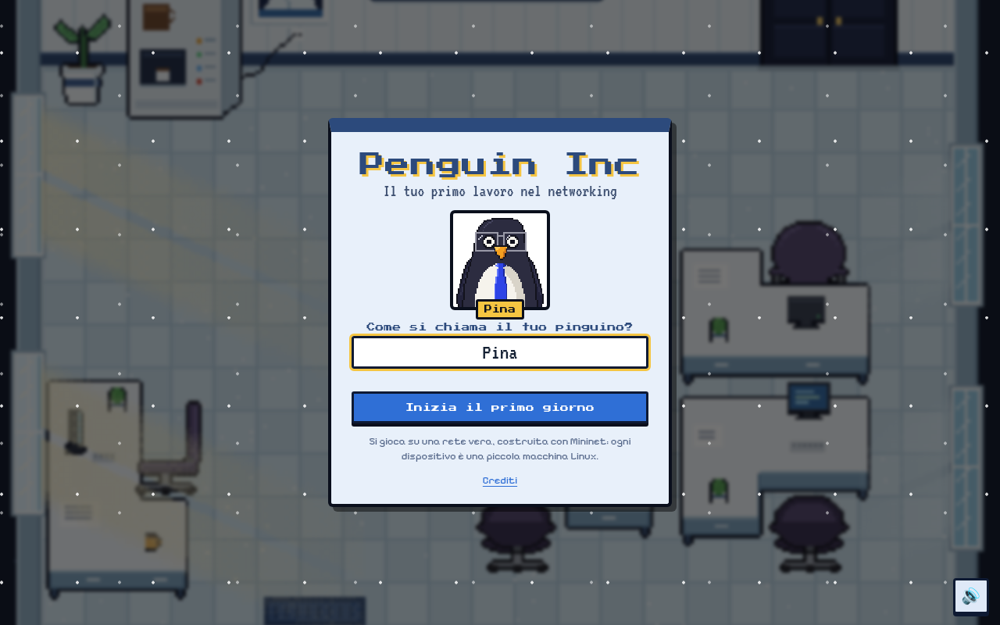
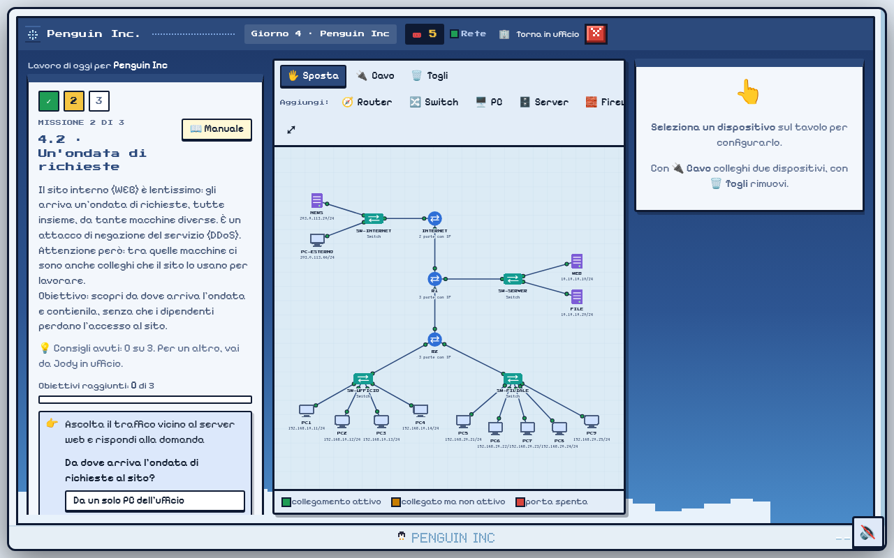

<p align="center">
  
</p>

<p align="center">
  <b>Penguin Inc. — Open Network Academy</b><br>
  Un serious game sulle reti e la cybersicurezza, dove si gioca su una rete vera costruita con
  <a href="https://mininet.org/">Mininet</a>.<br>
  Nato a <b>The Big Hack 2026</b> · challenge <b>C4 Consorzio Clara</b>
</p>

---

## The Big Hack 2026

**Penguin Inc.** è il progetto del team **Los Penguinos** per
[The Big Hack 2026](https://go.codemotion.com/big-hack-hackathon-2026/), l'hackathon di **Codemotion × Futuro
Remoto** alla **Città della Scienza di Napoli**, il 14 e 15 novembre 2026.

La challenge **C4 · Consorzio Clara** chiedeva un **serious game educativo sul networking e la cybersicurezza** per
chi è alle prime armi. La nostra risposta è un gioco in cui ogni rete è vera: quello che il giocatore costruisce
nel browser diventa una rete di macchine Linux, e il gioco la verifica con ping, tracce e connessioni reali.

## La storia

Sei un pinguino al primo giorno di lavoro a **Penguin Inc**, un'azienda antartica che si occupa di reti e
sicurezza. **Jody**, la collega senior, ti accoglie in ufficio. Ogni giorno ci sono tre *challenge*, e la difficoltà
cresce un po' alla volta. Se ti blocchi, vai da Jody: il primo giorno ti dà consigli gratis, dal secondo li paga
un caffè della macchinetta, comprato con i buoni guadagnati.

<p align="center">
  
  
</p>

Il lavoro si fa al **computer**, cioè un'interfaccia collegata alla rete vera. Lì si aggiungono dispositivi e cavi,
si configurano indirizzi, rotte, DHCP, DNS, firewall, ACL e limiti di velocità, si fanno ping e si ascolta il
traffico con uno sniffer. Il pulsante **Verifica** prova il traffico vero sulla rete.

<p align="center">
  
</p>

| Giorno | Tema | Le tre challenge |
|---|---|---|
| 1 | Le prime reti | la prima LAN (tutorial guidato), l'uscita verso l'esterno con un router, due reparti separati |
| 2 | Una sala server | sala server dietro un secondo router con DHCP, nomi al posto degli indirizzi (DNS), firewall con regole per servizio |
| 3 | Proteggere un cliente | una DMZ con due firewall, una sottorete per chi lavora in VPN, i servizi nel cloud dietro un firewall |
| 4 | **DEFCON 1**: attacco in corso | tentativi di accesso a raffica (forza bruta), un'ondata di richieste (DDoS), una *reverse shell* verso l'attaccante |

Il quarto giorno l'ufficio va in allarme: **le foche attaccano**. Il Capo, un orso polare, ti convoca nella
**war room** e a ogni attacco ti spiega, agitatissimo, cosa sta succedendo. Con lo sniffer scopri chi attacca e lo
fermi senza bloccare chi lavora. Alla fine arriva la **promozione**.

<p align="center">
  
  
</p>
<p align="center">
  
</p>

## Perché è utile

- **Niente simulazioni finte.** Ogni dispositivo è una piccola macchina Linux con la sua rete (un namespace
  creato da Mininet): i ping sono ping veri, il firewall è `nftables`, il DHCP è `dnsmasq`, lo sniffer è
  `tcpdump`. Quello che si impara vale fuori dal gioco.
- **Si impara facendo.** Ogni challenge dice *cosa* ottenere, non *come*: la soluzione la trova il giocatore, con il
  Manuale (la teoria in pillole) e i consigli di Jody, dal più vago al più preciso.
- **Le verifiche controllano il risultato, non la ricetta.** Il gioco riconosce la forma della rete e prova il
  traffico: vale qualsiasi soluzione corretta, con i nomi e gli indirizzi scelti dal giocatore.
- **Dalle basi alla difesa.** Si parte da due PC e uno switch e si arriva a DMZ, VPN, rate limiting e risposta agli
  incidenti.
- **La console dei router** usa la sintassi da riga di comando più diffusa nel settore (`interface`, `ip address`,
  `ip route`, `access-list`, `router ospf`…), la stessa di FRR e di molti apparati reali.
- **I contenuti si cambiano senza programmare.** Storia, challenge, testi e reti di partenza sono file YAML in
  `frontend/demo/gioco/`.
- **Tutto open source**, e gira su un computer qualsiasi con Docker.

## Come funziona

```
Browser ──HTTP──▶ server.py ──▶ motore di rete ──▶ modello della rete ──▶ Mininet (namespace Linux)
                                     │                                        veth, bridge, nftables,
                                     └──▶ console dei router                  tc, dnsmasq, tcpdump
```

- **Client** (`frontend/demo/`): l'ufficio in pixel art (`scripts/storia.js`) e il computer collegato alla rete
  (`scripts/app.js`), in HTML, CSS e JavaScript, senza framework.
- **Server** (`backend/server.py`, Python e Starlette): azioni sulla rete, lavori lunghi con avanzamento, verifiche
  e salvataggio della partita.
- **Motore di rete** (`backend/rete/`): un **modello** della rete (dispositivi, cavi, configurazioni, tabelle di
  routing statiche e OSPF, VLAN), la **console** dei router e degli switch, la **traccia** di un pacchetto passo per
  passo (dice anche quale riga di quale ACL lo scarta) e il **kernel**, che realizza il modello con Mininet: un
  namespace per dispositivo, coppie veth per i cavi, bridge Linux con le VLAN per gli switch, `nftables` per ACL e
  firewall, `tc` per i limiti di velocità, `dnsmasq` per DHCP e DNS, piccoli servizi Python per web, FTP e posta.
- **Motore di gioco** (`backend/missions.py`, `rescue.py`, `firewall.py`): controlli sulla forma della rete e
  verifiche sul traffico vero (ping, tracce, porte TCP, risoluzione dei nomi, limiti di velocità).
- **Contenuti** (`frontend/demo/gioco/*.yaml`): la storia, le challenge e i testi; le reti di partenza sono
  topologie YAML in `gioco/reti/`.

Senza Mininet (per esempio avviando il server su macOS fuori da Docker) il gioco parte da solo in **modalità
simulata**: stesse regole, ma le prove si calcolano sul modello invece che con traffico vero.

Il motore ha anche un secondo modo di giocare, il **Pronto Soccorso**, disponibile dall'API: il gioco costruisce
una rete, la guasta di proposito e consegna un ticket con i sintomi da riparare.

## Avvio

Serve [Docker](https://docs.docker.com/get-docker/) (Docker Desktop su macOS e Windows, Docker Engine su Linux).

```bash
docker compose up -d --build
```

Poi apri http://127.0.0.1:8787. Su macOS basta un doppio clic su
[`Avvia Penguin Inc.command`](Avvia%20Penguin%20Inc.command) (su Linux: `bash "Avvia Penguin Inc.command"`).
Per fermarlo: `docker compose down`.

- **Il container non ha privilegi**: gira come utente normale, senza capability e senza `privileged`. Il server crea
  un suo *user namespace* e lì dentro costruisce la rete del gioco, isolata dal computer (dettagli in
  [`docker-compose.yml`](docker-compose.yml) e in [ARCHITETTURA.md](backend/docs/ARCHITETTURA.md)).
- **Il gioco risponde solo a questo computer** (porta aperta su `127.0.0.1`). Per giocare da altri dispositivi
  servono un codice di accesso (`PNA_CODE`) e la porta aperta sulla rete locale nel `docker-compose.yml`.
- **Modalità collaudo** (`PNA_COLLAUDO=1 docker compose up -d`): cheat per provare il gioco (salta una challenge,
  vai a un giorno, buoni caffè) e controlli automatici all'avvio dei livelli. Non va usata in una demo pubblica.
- La partita e la rete sono salvate nel volume Docker `partita`: `docker compose down -v` riparte da zero.
- **Senza Docker**: `python3 backend/server.py` (servono `starlette`, `uvicorn` e `pyyaml`). Su Linux con Mininet
  installato la rete è vera, altrimenti simulata; `PNA_RETE=simulata` la forza simulata.

Copione della demo e soluzione dei problemi più comuni: [DEMO.md](DEMO.md).

## Documentazione

- [DEMO.md](DEMO.md): checklist, copione della demo, cosa fare se qualcosa va storto.
- [frontend/demo/README.md](frontend/demo/README.md): il client, la storia di Penguin Inc e come cambiare i contenuti.
- [backend/docs/API.md](backend/docs/API.md): l'API HTTP, endpoint per endpoint.
- [backend/docs/ARCHITETTURA.md](backend/docs/ARCHITETTURA.md): come funziona dentro, come aggiungere challenge,
  livelli e reti di partenza.

## Team

**Los Penguinos**: [Pasquale Criscuolo](https://github.com/Paki64), [Giovanni Di Stazio](https://github.com/giovannids100),
[Francesca Morra](https://github.com/fra494).

## Crediti

Musica: «Stumble Around» e «Face the Facts» di Zane Little, dall'album
[*A Bag of Chips [Vol. 1]*](https://zanelittle.bandcamp.com/album/a-bag-of-chips-vol-1) (2022), licenza
[CC BY 4.0](https://creativecommons.org/licenses/by/4.0/deed.it). La rete del gioco usa
[Mininet](https://mininet.org/) (licenza in [`deploy/MININET-LICENSE`](deploy/MININET-LICENSE)). Dettagli in
[`CREDITI.md`](CREDITI.md).
